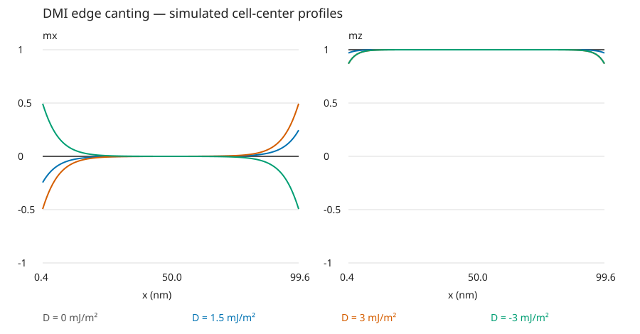

# Paper reconstruction: DMI bends magnetization at an edge

**Target:** the edge-canting phenomenon in Fig. 1 of S. Rohart and A. Thiaville, *Skyrmion confinement in ultrathin film nanostructures in the presence of Dzyaloshinskii–Moriya interaction*, Phys. Rev. B 88, 184422 (2013). Read the [public full text, Sections II and III A](https://arxiv.org/html/1310.0666v1) and [publication record](https://doi.org/10.1103/PhysRevB.88.184422). This example selects the edge profile, not the paper's later skyrmion results. The script, analysis and generated plot are original implementations; no paper figures or external code are bundled.

## What we take from the article

Fig. 1(a) studies a 100 nm strip, uniform along y, initially magnetized along +z. Interfacial DMI tilts opposite edges in opposite x directions while the center stays nearly perpendicular. Section II uses exchange `A=16 pJ/m` and effective perpendicular anisotropy `K_eff=510 kJ/m³`; Fig. 1(a) uses `D=3 mJ/m²`. The local approximation absorbs the dipolar contribution into `K_eff`.

That gives a minimal model: exchange + effective anisotropy + interfacial DMI, no applied field. Equation (8) gives the boundary scale `|mx| = |D|/(2 sqrt(A K_eff))`; the decay length is `sqrt(A/K_eff)`, about 5.6 nm. We use these to interpret the result, rather than to set a pass/fail threshold.

## Turn that into a short simulation

`script.mx3` uses 128 x 1 x 1 cells across the 100 nm width, with periodic y and finite x. The chosen 0.78125 nm x spacing resolves the edge variation. The 1 nm y/z cell dimensions and damping 0.5 are demonstration choices; `Msat=1.1 MA/m` is borrowed from the paper's full-dipolar comparison. With demagnetization disabled and `Ku1=K_eff`, this is the paper's local-energy approximation, not that full-dipolar calculation.

MuMax3's `Dind` convention has the opposite sign to the paper's Eq. (2), so the script uses **`Dind=-D_paper`**. Keep `OpenBC=false` to retain its DMI boundary treatment and avoid x periodicity, which would remove the target edges. The [official API](https://mumax.github.io/api.html) supplies the parameter names and units; the [DMI implementation](https://github.com/mumax/3/blob/6e5c98bb/cuda/dmi.cu) shows the derivative signs and treatment of missing neighbors.

The protocol is simply `Uniform(0,0,1) → Relax → save profile`. Four independent preparations at paper-convention D = 0, 1.5, 3 and -3 mJ/m² give a zero-interaction control, a strength comparison and a sign reversal. Those extra controls are our teaching choices. A global `mx` average would almost cancel, so the observable comes from spatial OVFs.

From this folder, using a new output name:

```text
mumax3 -http= -o edge.out script.mx3
python ../../scripts/analyze_edge_canting.py edge.out
```

The run writes `table.txt` with the actual parameters and `m_case_0.ovf` through `m_case_3.ovf`. Analysis reads the text OVFs, prints edge/center values, and writes `analysis/profiles.csv` and `analysis/profiles.svg`. Open the SVG to compare `mx(x)` and `mz(x)`. Its x coordinates are cell centers measured from the left edge; the continuum expression refers to the boundary itself.

## Result note from an actual run

- **Target/source:** Fig. 1 edge canting and its response to DMI strength/sign.
- **Model:** reported A, K_eff and width; the local-energy approximation, chosen mesh/damping and extra controls above.
- **Run/result:** MuMax3 3.12 (`6e5c98bb`, CUDA 12.9), RTX 5060 Laptop GPU, 2026-10-31; all four relaxations completed in 3.72 s. Rightmost-cell `mx` was 0, 0.24538, 0.49411 and -0.49411 respectively; the left edge had the opposite sign and central `mz` was approximately 1. The spatial profiles and controls recover the selected phenomenon. For context, continuum boundary magnitudes at positive D are 0.26255 and 0.52511; no figure digitization or quantitative fit was performed.
- **Next adjustment:** if closer edge amplitudes matter, increase `nx` at fixed width and compare nearer-boundary samples. The first reconstruction already shows the intended shape and trend.



## How to adapt when the picture differs

- No edge signal: inspect the OVF rather than average `mx`; check `Dind`, finite x boundaries and `OpenBC` before increasing runtime.
- Wrong tilt direction: compare the paper's DMI energy sign and the chosen +z initial state. Reverse D as a diagnostic.
- Tilt too broad or narrow: vary A or K_eff using the `sqrt(A/K_eff)` length scale. Smaller K_eff broadens the edge region; increasing |D| increases tilt in this regime.
- An entirely modulated state: reduce |D| first. The paper's quoted critical scale is about 3.6 mJ/m²; the simple near-uniform edge picture changes beyond it.

For a full-dipolar extension, turn demagnetization on and replace effective anisotropy with the corresponding magnetocrystalline value, rather than counting the local shape contribution twice. That is a separate model change, not needed to obtain this first phenomenon reconstruction.
